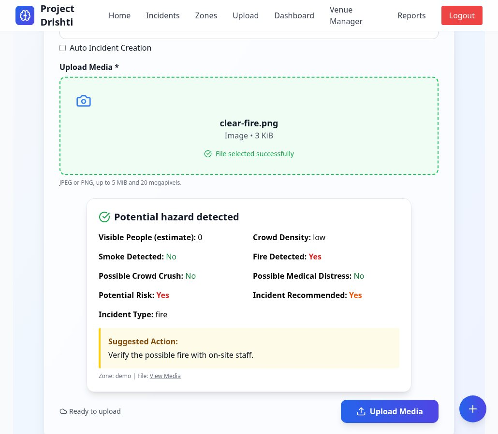

# Project Drishti

Project Drishti helps venue control-room operators and event safety leads review a still image when they need a quick read on crowding or a possible hazard. Choose a venue zone and upload one JPEG or PNG. Gemini estimates the visible people and apparent density, flags signs such as smoke, fire, possible crowd crush or medical distress, and suggests what to verify. An operator makes the response decision.

Input is one complete, nonempty still JPEG or PNG, up to 5 MiB and 20 megapixels. The zone is required. Notes are optional and stored as upload metadata. The vision prompt uses image evidence.



[Watch the 12-second demonstration](docs/analysis-demo.webp). The upload page shows a potential fire, a clear negative, an obscured scene requiring manual review, and a simulated Gemini timeout. The demonstration uses the real UI and analysis route with scripted model responses and simulated storage.

## What runs today

| Feature | Status | Scope |
| --- | --- | --- |
| Still-image upload and analysis | Implemented | Signed Cloud Storage upload, image validation, Gemini findings and suggested next steps. |
| Visible people count, density and hazard flags | Implemented | Estimates and flags for the submitted frame. Accuracy on real event footage is unmeasured. |
| No detection, uncertainty and failure states | Implemented | Distinct UI outcomes and actionable API errors. |
| Occupancy updates and automatic incident processing | Experimental | Opt-in Firestore write and Pub/Sub handoff. Uncertain and failed analyses skip automation. |
| Crowd forecasting | Experimental | Dashboard calls the configured Vertex prediction endpoint. Historical series is a placeholder and feature inputs can fall back to defaults. Forecast accuracy is unmeasured. |
| Multi-source fusion | Planned | The image analyzer processes one image per request. |
| Video, live camera feeds and motion analysis | Planned | The supported analysis inputs are still images. |

## Architecture

```text
JPEG / PNG + zone → React upload → FastAPI signs a size-bound Cloud Storage PUT
  → FastAPI matches the upload record, checks size/type, and decodes the image in memory
  → Vertex AI Gemini returns structured JSON → server validates the findings
  → UI shows detected / no detection / uncertain, or an actionable analysis error
  → optional Firestore occupancy update and Pub/Sub handoff for detected hazards
```

“No visible hazard detected” means the model returned valid findings without a positive hazard flag. “Uncertain” requests manual review and hides potentially misleading definitive flags in the UI. “Analysis failed” covers unavailable or unusable results and has its own HTTP error response. The model request has a 20-second transport timeout and at most one retry for transient failures. Malformed output fails immediately. The analyzer creates no local temporary files. A browser disconnect can leave an in-flight server request running until it finishes or times out.

## Run the evaluation offline

From the repository root, with Python 3.12:

```bash
git clone https://github.com/pspcps/Agentic-Project-Drishti.git
cd Agentic-Project-Drishti
python3.12 -m venv .venv
source .venv/bin/activate
pip install -r backend/evaluation/requirements.txt
cd backend
python -m evaluation.run
```

The runner needs no credentials in its default mode. It prints each case and its elapsed time, and exits nonzero on an expectation mismatch. To regenerate the original synthetic PNGs, run `python -m evaluation.generate` from `backend/`.

| Case | Input | Outcome |
| --- | --- | --- |
| Clear positive | [Synthetic plaza fire](backend/evaluation/images/clear-fire.png) | Potential hazard detected |
| Clear negative | [Empty plaza](backend/evaluation/images/empty-plaza.png) | No visible hazard detected |
| Ambiguous | [Obscured glow](backend/evaluation/images/obscured-glow.png) | Uncertain, manual review needed |
| Failure | Positive image with injected timeout | Analysis failed with retry or manual review guidance |

### Evaluation results

The [reviewed manifest](backend/evaluation/cases.json) contains 12 cases. Six are original synthetic stills with recorded visual review notes, four exercise input validation, and two inject model failures. The scripted run matched **12/12** expectations. Median analyzer time for the six stills was **1.5 ms** on the development machine, including local image validation. The scripted timeout took about **500 ms** with the retry delay and an immediately raised timeout. These timings exclude network calls, uploads and model inference.

For a live run, supply application credentials and set `GCP_PROJECT`, `GCP_REGION`, and optionally `DRISHTI_VISION_MODEL`, then run `python -m evaluation.run --live` from `backend/`. It submits six stills to Vertex, keeps validation and failure cases offline, and reports fire precision, recall, false positives, decision coverage and analyzer time. Five frames have binary fire labels. The ambiguous frame is scored separately for uncertainty. A positive with no usable decision lowers recall. Precision is undefined when there are no positive predictions. Individual case times expose the effect of blur and darkening.

Live model metrics are **unmeasured** in the checked-in results. The set uses simple illustrations, includes a degraded derivative of a positive example, and supports a smoke test for visible fire and uncertainty. It is too small to estimate real-event performance and has no calibrated labels for smoke, crowd density, count accuracy, medical distress or crowd crush.

## Run the image upload API with Google Cloud

The focused local API mounts the same upload and analysis routes used by the dashboard backend. Bind it to loopback for development. It has no login middleware.

1. Use a development Google Cloud project with billing, Vertex AI, Firestore in Native mode and a private Cloud Storage bucket. Give your application credentials access to read and write Firestore records, read and upload bucket objects, sign V4 PUT URLs and invoke Vertex. Use your own signing-capable credentials stored outside the checkout. Create `zones/demo` in Firestore with `name: "Demo plaza"`.
2. Activate the Python environment created above, then run from `backend/`:

   ```bash
   pip install -r requirements-vision.txt
   export GCP_PROJECT=your-development-project
   export GCP_REGION=us-central1
   export GOOGLE_APPLICATION_CREDENTIALS=/absolute/path/to/your-signing-credentials.json
   export DRISHTI_VISION_BUCKET=your-private-image-bucket
   export DRISHTI_VISION_MODEL=gemini-2.5-pro
   uvicorn vision_local:app --host 127.0.0.1 --port 8000
   ```

   Select a model and location available to your project. Open the [local OpenAPI docs](http://127.0.0.1:8000/docs) to inspect the request shapes. Run `python -m unittest evaluation.test_api` with the same dependencies for HTTP regressions without cloud calls.

3. From `backend/` in a second terminal, upload the sample and trigger analysis with curl and jq:

   ```bash
   sample=evaluation/images/clear-fire.png
   size=$(wc -c < "$sample")
   upload=$(curl --fail-with-body -sS http://127.0.0.1:8000/api/upload/presigned-url \
     -H 'Content-Type: application/json' \
     -d "{\"filename\":\"clear-fire.png\",\"mimetype\":\"image/png\",\"size\":$size,\"zone\":\"demo\",\"type\":\"vision\"}")
   curl --fail-with-body -sS --upload-file "$sample" -H 'Content-Type: image/png' \
     "$(jq -r .url <<<"$upload")"
   jq '{fileUrl, docId, zone: "demo", autoIncident: false}' <<<"$upload" | \
     curl --fail-with-body -sS http://127.0.0.1:8000/api/analyze-media \
       -H 'Content-Type: application/json' --data-binary @-
   ```

The React client can target an authenticated Drishti backend via `VITE_API_BASE_URL` (include `/api`). Use Node.js 22.12+, run `npm ci` and `npm run dev` from `frontend/`, and set `VITE_FIREBASE_PROJECT_ID` and the other web configuration values in [firebase.js](frontend/src/firebase.js) for the development Firebase project. The bucket needs to allow signed PUTs from the frontend origin. Sign in with a development operator account and choose **Upload**. Keep automatic incident creation off for sample images.

## Limitations and operating costs

- A single frame has limited coverage. Glare, haze, motion blur and occlusion can cause missed hazards or false alarms. Counts cover visible people and can vary across runs. The model cannot verify crowd movement or diagnose distress from a still. Keep an operator in the loop.
- Uploads and Firestore metadata are persistent application records, including uploads where analysis was canceled or failed. Configure bucket lifecycle and record retention for approved images. The bucket can remain private and its direct media link will require appropriate access.
- Offline evaluation has no cloud charges. Live analysis bills image/prompt and output tokens per attempt, with at most two requests for a retryable failure. Multiply attempts by the configured model’s current input/output rates and add Cloud Storage operations and retention, Firestore reads/writes, optional Pub/Sub traffic and API hosting. For example, 100 images with 10 retries mean 110 model requests. Forecasting uses a separate Vertex endpoint and can incur deployment and prediction costs. [Vertex pricing](https://cloud.google.com/vertex-ai/generative-ai/pricing) · [Cloud Storage pricing](https://cloud.google.com/storage/pricing) · [Firestore pricing](https://cloud.google.com/firestore/pricing)
